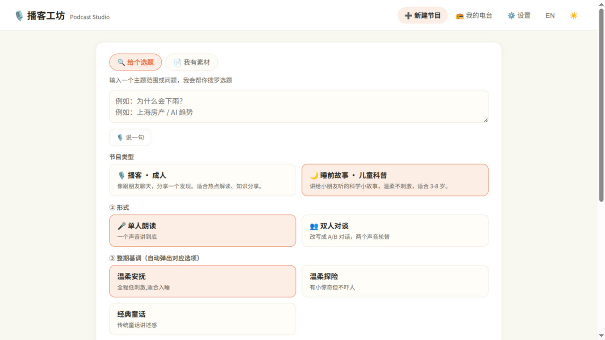
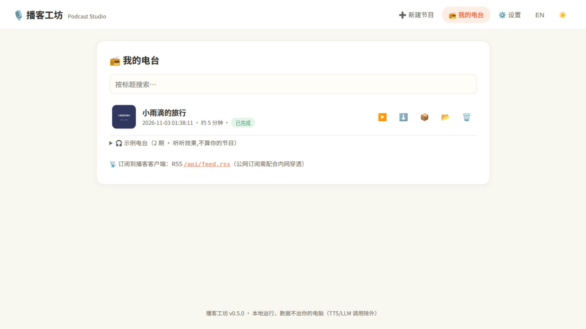
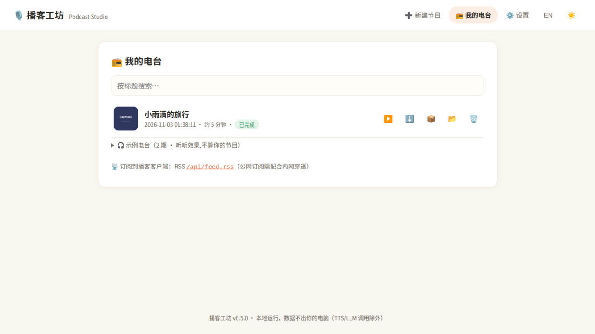
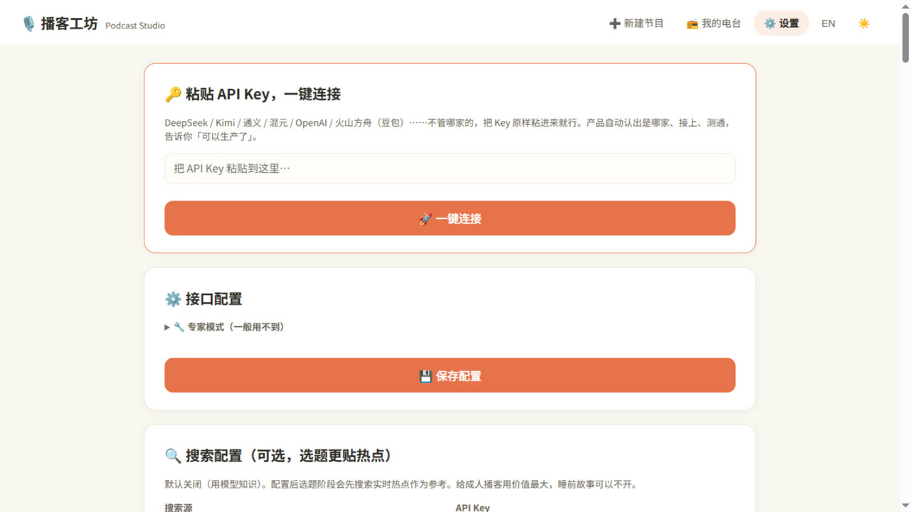

# 播客工坊 Podcast Studio 🎙️

> **装在你自己电脑上的播客与睡前故事工作室——用你的声音讲，每一集都由家长审定，数据不出门。**
>
> 一条命令起服务，浏览器里点一点，把你的选题或知识变成用你声音录制的音频节目。
>
> **A self-hosted podcast & story studio** — one command to serve, click through in your browser, and turn your topics or knowledge into audio episodes narrated in your own cloned voice.

[中文](#为什么做这个) | [English](#english)

---

## 产品截图

<table>
<tr>
<td></td>
<td></td>
</tr>
<tr>
<td></td>
<td></td>
</tr>
</table>

<p align="center"><i>左上:新建节目(联动式) · 右上:完成页(试听+shownotes+重录) · 左下:我的电台 · 右下:设置(一键连接)</i></p>

## 为什么做这个

给孩子讲睡前故事，网上内容找不到、质量也没法把控？把你想讲的知识输进去，用**你自己的声音**生成一期温柔的科学小故事。想做成人播客（热点解读、知识分享）？同一个引擎，换一种节目类型。

**两种输入模式：**

- 🔍 **给个选题** — 输入主题范围（如"为什么会下雨"、"上海房产"），自动搜罗候选选题，你挑一个
- 📄 **我有素材** — 粘贴你已经掌握的知识/内容，以此为准改写，**内容你说了算**

## 产品设计理念

这些是产品在迭代过程中沉淀下来的设计决策，不是拍脑袋：

### 先设置，后选服务

声音下拉里只出现你已经接好的 TTS 服务。没配 Key 的服务不出现——选择即代表可用。配了新 Key 后自动解锁对应音色组。

### 示例先行，隐私有据

装好即有两期随包示例（我的电台 → 🎯 示例电台），零配置秒听效果；设置页「关于与信任」写明数据放哪、儿童内容怎么过滤、哪些永远免费。

### 粘贴 Key 就够了

普通用户不应该需要理解"火山方舟"、"DashScope"这些控制台概念。把任意厂商的 API Key 粘贴进来，产品拿它逐厂商真实验证（GET models），认出是谁家就自动配好，然后告诉你"可以生产了"。装了 CC Switch 或 Magpie 网关的用户更简单——自动发现已配置的供应商，零打字。

### 情绪跟着内容走

写稿前先派一个「情绪导演」分析内容讲的是什么、听众是谁，规划 4-6 个节拍的情绪弧线（如睡前故事：温柔开场 → 娓娓道来 → 小小惊奇 → 轻轻解释 → 安心收尾）。写稿严格按弧线演绎，而不是机械套模板。结构模板（12 个可查证来源）决定节目怎么铺陈，弧线决定每一拍的情感温度。

### 时长是学出来的

选了 5 分钟但只出 3 分钟？产品会从每一期真实节目学习「字符/秒」的实际语速，动态修正下一期的字数目标。用得越多，时长越准。

### 宁可少，不可错

给孩子的内容，宁可少一集，也不能搜到乱七八糟的东西。搜索结果过黑名单+敏感词净化（儿童模式强制），事实核查轮有硬性预算（≤3 轮），没有把握的选题直接丢弃——不碰运气。

### 会延迟失败的操作，必须在入口拦截

凡是注定要在后面失败的配置（如克隆声音需要 MiMo 引擎），在入口处就拦截或预告，绝不让你做完两分钟的事才告诉你第一步就不成立。错误信息永远说人话、给下一步；合成失败时文稿依然是你的，随时可导出。

### 单人双人，同一个引擎

选单人朗读→豆包 TTS 分段合成（每段带情绪标签映射到风格指令）；选双人对谈→方舟播客 API 一次会话生成整期（文稿先改写为 A/B 对话轮次）。自动降级：没有方舟 Key？用 edge-tts 双音色轮替，功能不打折。

## 快速开始

```bash
# 方式一:一键安装脚本(推荐,含 ffmpeg 检测 + 桌面快捷方式)
bash install.sh

# 方式二:手动
pip install -e .   # Python ≥ 3.10;另需系统安装 ffmpeg

# 启动服务
podcast-studio serve
# ➡️ 打开 http://localhost:8686
```

默认以**演示模式**运行（无需任何 API key，用内置示例文稿 + 免费 edge-tts 合成真实语音），可以先完整体验流程。

然后去 **⚙️ 设置** 里：

1. **粘贴 API Key**：不管哪家的（DeepSeek / Kimi / 通义 / 混元 / OpenAI / 火山方舟豆包），原样粘进来，产品自动认出是谁家、接上、测通
2. （可选）在「我的声音」上传 30-60 秒录音，克隆你自己的声音（依赖 MiMo TTS）
3. （可选）装了 CC Switch / Magpie 网关？点「🔎 检测」自动发现供应商

### 命令行（无界面）

```bash
podcast-studio make "上海房产" --style podcast          # 选题模式，交互选题
podcast-studio make story.txt --material --style bedtime --yes  # 素材模式，全自动
podcast-studio make "为什么会下雨" --style bedtime --voice "edge:zh-CN-XiaoxiaoNeural"
podcast-studio backup                    # 备份节目/声音/校准（默认 ~/.podcast-studio/backups）
podcast-studio clean                     # 预览可清理的缓存（加 --yes 才删除）
podcast-studio restore <备份.zip>        # 恢复（恢复前自动快照当前数据）
podcast-studio doctor --probe            # 真实连通性验证（LLM/TTS/搜索）
podcast-studio doctor --bundle           # 生成脱敏诊断包
```

> 📖 **图文使用手册**:[docs/USAGE.md](docs/USAGE.md) — 安装、睡前故事路径、克隆声音、定时生成、常见问题

## 工作流程

```
┌──────────┐   ┌──────────┐   ┌──────────┐   ┌──────────┐   ┌──────────┐
│ 选题/素材 │ → │  LLM 写稿 │ → │ 合规审查  │ → │ 人工确认  │ → │ TTS 合成  │
│ (可搜索)  │   │ 情绪标签  │   │ 分维度报告│   │ 可改稿    │   │ 分段+合并 │
└──────────┘   └──────────┘   └──────────┘   └──────────┘   └──────────┘
                                                                    ↓
                                     成品 MP3（44.1kHz · -16 LUFS · ID3 + 封面）
```

- 每一步落盘（`~/.podcast-studio/data/episodes/<id>/`），合成失败**从失败分段续跑**
- 文稿每段带情绪标签，合成时映射为 Provider 的风格指令；不支持情绪时自动降级为语速/音调
- 合成前必须人工确认，改稿后自动重新审查
- 单段不满意可**单独重录**，其余不动
- 搜索结果过**内容安全过滤**（黑名单+敏感词，儿童模式强制），事实核查轮（≤3 轮）

## Provider 架构

| 层 | 抽象 | 已实现 | 接入成本 |
|----|------|--------|---------|
| LLM | OpenAI 兼容协议 | MiMo / DeepSeek / Qwen / Kimi / OpenAI…（一个实现通吃）+ 演示模式 | 粘贴 Key 一键连接 |
| TTS | 能力探测 + 优雅降级 | **edge-tts**（免费）、**豆包 TTS**（情绪风格 + 声音克隆）、**方舟播客**（双人整期）、**阿里 CosyVoice**、**ElevenLabs**、**Azure** | 新增 provider 实现一个类 |
| 搜索 | 可选 | Tavily / 博查（选题热点注入） | 填 Key |

TTS 能力矩阵：

| | 情绪风格 | 声音克隆 | 费用 |
|---|---|---|---|
| edge-tts | ✗（降级为语速/音调） | ✗ | 免费 |
| 豆包 TTS | ✓ 按段风格指令 | ✓ 30-60s 采样 | 目前免费 |
| 方舟播客 | ✗（对话自带节奏） | ✗ | 按量 |
| 阿里 CosyVoice | ✗（降级语速/音调） | ✓ 复刻音色 ID 直传 | 按量 |
| ElevenLabs | ✗（style 参数近似） | ✓ | 按量 |
| Azure | ✓ SSML express-as | ✓ Custom Voice | 按量 |

## 输出

每期节目一个目录：`文稿 script.md` / `纯文稿 script_clean.txt` / `分段 chunks/` / `成品 audio.mp3`（响度归一化 -16 LUFS，ID3 + 封面附图），可在「我的电台」回放、下载、打包导出。

## 项目结构

```
podcast-workflow/
├── podcast_studio/
│   ├── engine/            # 流水线:选题/写稿/合规/分段/音频/封面/状态机/校准
│   ├── providers/
│   │   ├── llm/           # OpenAI 兼容 + 演示模式
│   │   ├── tts/           # edge-tts / MiMo / 豆包 / 方舟播客 / CosyVoice / ElevenLabs / Azure
│   │   ├── search.py      # Tavily / 博查
│   │   ├── gateways.py    # CC Switch / Magpie 网关探测
│   │   ├── keymatch.py    # 粘贴 Key 自动匹配
│   │   └── voices.py      # 声音库(克隆采样管理)
│   ├── server/            # FastAPI + 静态 Web UI(无构建链)
│   │   ├── uploads.py     # 上传护栏(大小/魔数/时长)
│   │   ├── scheduler.py   # 每晚定时生成
│   │   ├── feed.py        # RSS feed
│   │   └── static/        # Web UI(无构建链)
│   ├── styles.py          # 节目类型 profiles(播客/睡前故事)
│   ├── config.py          # 配置(~/.podcast-studio/config.json,0600 权限)
│   ├── backup.py          # 备份/恢复 + 每日自动快照
│   ├── diagnostics.py     # doctor --bundle 诊断包
│   ├── probes.py          # doctor --probe 真实连通性探测
│   ├── net.py             # 代理环境兼容(ALL_PROXY=socks://)
│   ├── atomic.py          # 用户资产原子写
│   ├── cleanup.py         # clean 命令(缓存/残留/旧备份)
│   ├── logging_setup.py   # 轮转日志 + 密钥脱敏
│   ├── engine/usage.py    # 用量账本(字数/次数/费用估算)
│   └── cli.py             # serve/make/doctor/backup/restore/clean
├── scripts/               # smoke.sh / check_wheel.py
├── tests/                 # pytest(276 用例,含 API 全流程/真 ffmpeg/provider mock/打包回归)
├── docs/                  # 使用手册 + 截图
├── install.sh             # 一键安装
├── Dockerfile / docker-compose.yml
└── pyproject.toml
```

## 开发

```bash
bash install.sh              # 建 venv 装依赖
source .venv/bin/activate
pip install -e .[dev]
pytest -q                    # 276 个用例
ruff check podcast_studio/   # lint
```

## Roadmap

- **v0.2** — 引擎重构 + Web UI + edge-tts/MiMo + 两种节目类型 + 素材模式 + MP3 输出
- **v0.3–v0.4** — 一键安装/向导/测试连接、shownotes、单段重录、封面图、RSS、
  每晚定时生成、浏览器录音入库、火山/阿里/ElevenLabs/Azure provider、
  搜索热点注入(Tavily/博查)、Docker/CI/PyPI 就绪、时长校准闭环、情绪弧线导演、
  12 结构模板库、粘贴 Key 一键连接、本地网关探测(CC Switch/Magpie)、
  语速稳定指令、单段重合成、深色模式、移动端适配、PWA、i18n
- **v0.5** — 商业化冲刺:稳定性与安全(Host 防护/配置自毁防护/接线审计 8 项修复)、
  错误人话化双通道、`podcast-studio doctor` 自检、示例电台随包、SRT 字幕+ID3 章节、
  键盘可达/长流程陪伴/专家模式折叠、示例/真实节目隔离(origin 元数据)
- **v0.5.2** — 交付可靠性:wheel 数据文件修复、上传护栏、备份/恢复+每日快照、
  `doctor --probe` 真实联调、`doctor --bundle` 诊断包、轮转日志+密钥脱敏、
  端口冲突处理、代理环境兼容、CI 覆盖 Python 3.10–3.14 + wheel + 冒烟
- **v0.5.3（当前）** — 产品化收尾:用量账本(字数/次数)+ 可选费用估算、`clean` 清理缓存、
  节目归档(不删文件)、用户资产原子写、health 不泄路径、Docker 非 root + healthcheck、
  i18n 键一致性守门、字幕/RSS/调度边界测试补强
- **v0.6（规划）** — 封面插画化、动态消息 i18n 迁移、更多结构模板、独立 QA 例行深审

## 常见问题

| 问题 | 处理 |
|------|------|
| 合成失败:ffmpeg | 安装 ffmpeg(`apt/brew install ffmpeg`)后重试(失败会从失败分段续跑) |
| LLM 报认证失败 | 设置 → 测试连接，确认 Key/base_url(带 `/v1`)/模型名 |
| MiMo 证书错误 | 先更新系统证书或 certifi;关闭校验仅作最后手段 |
| 声音下拉 🔑 组合成报错 | 该组需要对应 Key(设置 → TTS 接口配置) |
| 换电脑迁移 | `podcast-studio backup` 后把 zip 拷到新机器，`podcast-studio restore <zip>`；也可直接拷贝 `~/.podcast-studio/` |
| 某期卡住/不想看 | 「我的电台」行内 🗃️ 归档（不删除，可随时取消）；执行中的节目不能归档 |
| 想知道每期花了多少 | 完成页「📊 本期用量」显示字数与调用次数；设置页填定价后可估算金额 |
| 数据备份 | 默认每日自动快照（有节目且距上次 24 小时，保留 7 份）；手动 `podcast-studio backup` |
| 代理导致连不上/测试全红 | `ALL_PROXY=socks://` 不被 httpx 支持；启动会自动忽略并提示，建议改用 `socks5://` 或设置 `HTTPS_PROXY` |
| 局域网/远程访问 | 默认只绑 `127.0.0.1`；要开放需在 config 设 `server.allow_lan=true`，但**本产品没有账号体系**，请只在可信网络使用 |
| 端口 8686 被占 | 默认会自动换下一个可用端口；若已有本产品实例在跑，会直接提示并退出 |
| 想给开发者看证据 | `podcast-studio doctor --bundle` 生成脱敏诊断包（不含 Key/音频/文稿） |
| Docker 部署 | `UID=$(id -u) GID=$(id -g) docker compose up -d`（非 root 运行 + healthcheck）；数据在 `./podcast-data` |

## 贡献

Issue / PR 欢迎，见 [CONTRIBUTING.md](CONTRIBUTING.md)。新增一种 TTS Provider 或节目类型 profile 是最好的入门任务。

## License

[MIT](LICENSE)

---

## English

**Podcast Studio** is a self-hosted local app (Python package + Web UI + CLI) that automates the whole pipeline: **topic research → script writing → compliance review → human approval → TTS synthesis → publish-ready MP3**. LLM, TTS and search are pluggable providers.

### Why

Can't find good bedtime stories for your kid — or control what's in them? Feed your own knowledge, and get a gentle science story narrated in *your* voice. Want an adult podcast (hot takes, knowledge sharing)? Same engine, different program profile.

### Quick start

```bash
bash install.sh            # or: pip install -e . (Python ≥ 3.10 + ffmpeg)
podcast-studio serve       # open http://localhost:8686
```

Runs in **demo mode** out of the box (no API keys; built-in sample scripts + free edge-tts synthesis). Then configure in ⚙️ Settings:

- **Paste your API Key** — DeepSeek / Kimi / Qwen / 混元 / OpenAI / Volcano Ark — any provider, just paste it and the app identifies, connects, and confirms
- **Your voice** — upload 30–60 s of audio once, use it everywhere (voice cloning via MiMo TTS)

### Highlights

- **Two input modes** — give a topic (auto candidate topics) or paste your own material (you control the content)
- **Program profiles** — 🌙 Bedtime Story (kid-safe compliance, gentle pacing) / 🎙️ Podcast (conversational); extensible
- **Emotion arc director** — before writing, an AI director analyzes the content and plans a per-beat emotion arc; the script follows it, not a template
- **Structure templates** — 12 podcast/story structures (NPR hook style, hero's journey, cumulative, etc.) with per-beat char budgets
- **Single-chunk re-synthesis** — re-record just the paragraph you don't like
- **Episode library** — shownotes, cover art, loudness-normalized MP3 with ID3 tags
- **Duration calibration** — learns your actual chars/sec from every episode; the more you use it, the more accurate the timing
- **Paste-Key connect** — any provider, paste and go; auto-detects CC Switch / Magpie local gateways
- **Reliable delivery** — backup/restore with daily snapshots, upload guardrails, live `doctor --probe`, redacted diagnostic bundle, rotating logs
- **Trustworthy content** — search results sanitized (blacklist + keyword filter, forced for kid mode), fact-check round with a hard budget (≤3 rounds), sources shown on topic cards
- **Providers** — TTS: edge-tts (free) / Xiaomi MiMo (emotion + cloning) / Volcano Doubao / Ark Podcast / Ali CosyVoice / ElevenLabs / Azure; LLM: any OpenAI-compatible endpoint

### Architecture & docs

See the [中文 README](#为什么做这个) for the full architecture map, provider matrix, roadmap and project structure — the codebase docs are bilingual, the code comments are Chinese.
